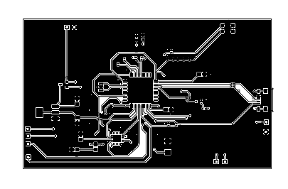
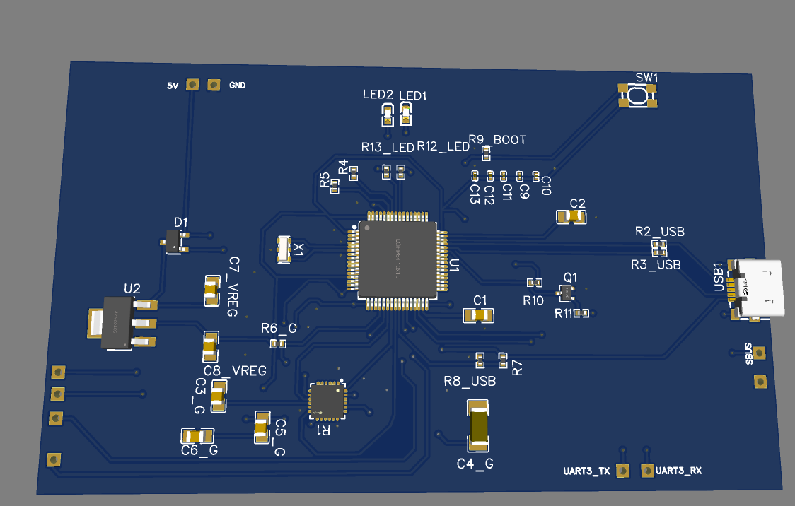

# Flight Controller

A custom-designed drone flight controller PCB built around the **STM32F405RGT6 microcontroller** and **MPU-6000 motion sensor**. This project focuses on designing the hardware and PCB required for a drone flight control system using EasyEDA.

### PCB Design

### 3D PCB Model

### Circuit Schematic
[View Circuit Schematic (PDF)](photos/Schematic_flight-controller-for-drone_2026-11-10.pdf)

## Hardware Components

| Component | Description |
|---|---|
| STM32F405RGT6 | Main microcontroller |
| MPU-6000 | 6-axis accelerometer and gyroscope |
| AMS1117-3.3 | 3.3V voltage regulator |
| 8 MHz Crystal | External clock source |
| Micro USB Connector | USB interface |
| Capacitors | Power filtering and decoupling |
| Resistors | Pull-up and circuit configuration |
| LEDs | Status indication |

## Made using EasyEda cad software

## lapse link
https://lapse.hackclub.com/timelapse/ObI46PSP9KcA

https://lapse.hackclub.com/timelapse/GmJQGRTYcXPa

https://lapse.hackclub.com/timelapse/THRoccMuE7IQ

## project video
https://user-cdn.hackclub-assets.com/01a1c68f-d476-7bca-a370-b7055f8c0308/screencast_from_2026-11-10_23-11-18.mp4

